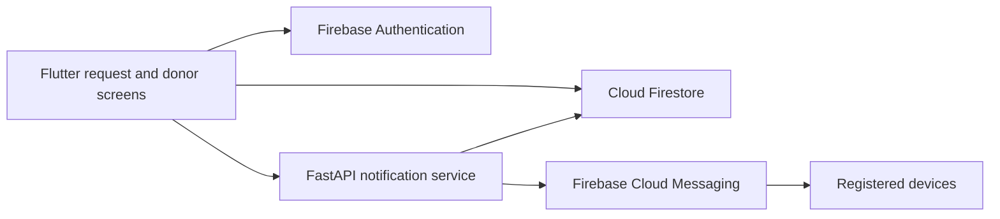

# EsperFlow

A Flutter blood donation coordination application with Firebase accounts, donor registration, blood requests, donation history, and a Python notification service.

The project demonstrates a mobile-to-cloud workflow in which the app manages user-facing records while a trusted backend holds Firebase Admin credentials and sends push notifications.

## Stack and architecture

Flutter / Dart `^3.10.0`, Firebase Authentication, Cloud Firestore, Firebase Cloud Messaging, and `http` form the client. FastAPI, Uvicorn, and the Firebase Admin SDK form the backend.



The client can create the initial request document and submit its ID to the API. The backend de-duplicates device tokens, excludes the supplied requester token, sends notifications, and records delivery counts. Compatibility counts are informational: the existing broadcast targets registered devices, not only blood-compatible donors. An optional setting restricts delivery to active donors.

## Setup

```sh
git clone https://github.com/Abdul-Hadi-Jalil/EsperFlow.git
cd EsperFlow
python -m venv backend/.venv
```

Activate the environment, then:

```sh
python -m pip install -r backend/requirements.txt
cd backend
```

Copy `.env.example` to `.env` and configure the Firebase project and server-only service account. The client and Admin credentials must target the same project.

```sh
python -m uvicorn app.main:app --reload --host 0.0.0.0 --port 8000
```

In another terminal, configure Firebase for your project in `frontend/`, including Auth, Firestore rules, and FCM platform setup, then:

```sh
cd frontend
flutter pub get
flutter run --dart-define=API_BASE_URL=http://10.0.2.2:8000
```

Use a LAN host for a physical phone or USB port reversal. Set the matching `API_KEY` Dart define when your backend requires one. The frontend otherwise defaults to a hosted backend; an existing URL is not evidence that it is currently available.

## Configuration

| Setting | Location / purpose |
| --- | --- |
| `FIREBASE_SERVICE_ACCOUNT_PATH` | Backend path to ignored Admin JSON |
| `FIREBASE_SERVICE_ACCOUNT_JSON` | Alternative raw/base64 server credential |
| `FIREBASE_PROJECT_ID` | Project matching the client |
| `API_KEY` | Backend write-request key; matching client build define |
| `CORS_ORIGINS` | Backend allowed origins |
| `NOTIFY_ONLY_ACTIVE_DONORS` | Optional active-donor filter |
| `API_BASE_URL` | Client compile-time backend URL |
| `API_TIMEOUT_SECONDS` | Client compile-time request timeout |

Keep Admin credentials on the server. A key embedded in a mobile app is extractable and should not be treated as per-user authorization.

## API and code map

The service exposes `/health`, `/ready`, and `/docs`, plus request creation/list/detail, notification resend, close, and donor-reach endpoints under `/api`.

- `frontend/lib/screens/`: authentication, requests, donors, profiles, history, directories.
- `frontend/lib/services/`: Firestore/API interactions and notifications.
- `backend/app/routers/`: request/response endpoints.
- `backend/app/services/`: donor reach and FCM delivery.
- `backend/README.md`: complete API schemas and configuration.
- `book/`: detailed project guide.

See the [backend guide](backend/README.md) and [project book](book/README.md).

## Verification and operational scope

Run `flutter analyze` and `flutter test` from `frontend/`. Check backend `/health` and `/ready` separately: liveness does not prove Firebase credentials work. Test FCM with dedicated development accounts/devices because creating or resending requests can send real notifications.

The app coordinates requests; it does not establish donor eligibility, medical compatibility, blood availability, or guaranteed emergency response. Before wider deployment, validate authorization, Firestore rules, notification behavior, and consent for the intended audience.
